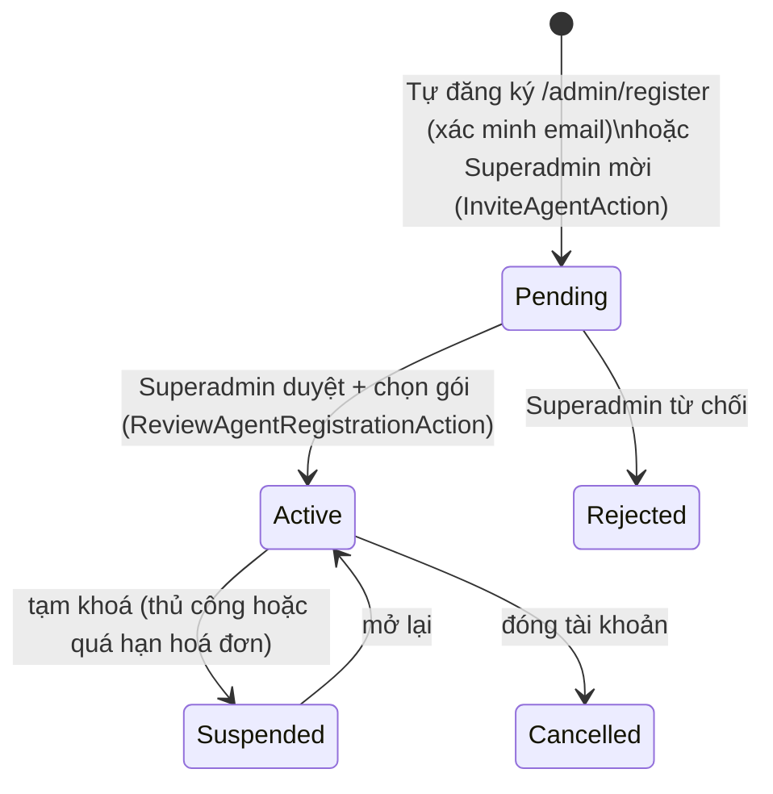

# 1. Xác thực & Phân quyền

[← Về Tổng quan nghiệp vụ](overview.md)

DrinkFlow có **ba hệ thống xác thực độc lập** dùng chung một database nhưng khác guard Laravel và khác bảng tài khoản:

| Guard | Model / bảng | Đăng nhập | Trang đăng nhập |
| --- | --- | --- | --- |
| `web` | `GlobalUser` / `global_users` | Google OAuth | `/auth/google` (callback `/auth/google/callback`) |
| `admin` | `Admin` / `admins` (Agent) | Email + mật khẩu (+ 2FA tuỳ chọn) | `/admin/login` |
| `superadmin` | `Superadmin` / `superadmins` | Email + mật khẩu (+ 2FA tuỳ chọn) | `/superadmin/login` |

Đăng nhập ở guard này không cho phép truy cập khu vực của guard khác.

## 1.1. Global User — Google SSO

- Đăng nhập qua OAuth 2.0 (`App\Http\Controllers\Auth\GoogleAuthController`), không lưu mật khẩu. Có thể giới hạn domain email bằng `GOOGLE_ALLOWED_DOMAINS`.
- `GlobalUserStatus`:
  - `Active` — dùng bình thường.
  - `Blocked` — bị khoá (vi phạm, nợ quá hạn); chỉ truy cập được `/blocked`, `/blocked/appeal`, `/logout` (403 JSON hoặc redirect).
  - `Disabled` — người dùng tự vô hiệu hoá tài khoản (`UserProfileService`); bị từ chối nếu còn công nợ.
  - `Deleted` — Superadmin xoá mềm: giữ lại lịch sử đơn/nợ, không cho đăng nhập.
- Middleware `ResolveGlobalUser` (`global.user`) resolve user từ session **hoặc** cookie thiết bị tin cậy (`drinkflow_device_uuid` + `drinkflow_trusted_token`), tự động đăng xuất nếu thiết bị đã bị thu hồi (xem [bài 10](10-bao-mat-thiet-bi-audit.md)).

## 1.2. Admin (Agent) — đăng ký, duyệt, đăng nhập

- Chỉ `AdminStatus::Active` được đăng nhập (`AdminStatus::canSignIn()`).
- Đăng nhập tại `Admin\AuthController` (captcha + rate limit), có OTP quên mật khẩu qua email và 2FA tuỳ chọn (`two_factor_enabled`, bật ở trang hồ sơ).
- Khi được duyệt, Agent nhận một thuê bao (`AdminSubscription`) với hạn mức số Room (`room_limit_snapshot`) — xem [bài 12](12-goi-dich-vu-thue-bao-hoa-don.md).

## 1.3. Phân quyền Admin theo Room

Middleware `admin.room` (`EnsureAdminRoomAccess`) gọi `RoomPolicy::operate`: Admin chỉ vào được Room khi **đang Active** và là **chủ sở hữu** (`rooms.owner_admin_id`) **hoặc cộng tác viên** (bảng `admin_rooms`) của Room đó; Room phải ở trạng thái `Active`. Biết slug/URL của Room khác cũng không truy cập được.

## 1.4. Superadmin — role & permission

- Model và guard riêng; `SuperadminStatus`: `Active` / `Suspended`.
- Mỗi Superadmin gắn một `SuperadminRole` (role mặc định `full` do `DatabaseSeeder` tạo) và danh sách permission có phạm vi (`PermissionScope`), đồng bộ từ enum `App\Enums\Permission` (`PermissionCatalogService`).
- Mọi route `/superadmin/*` kiểm tra permission cụ thể qua middleware `permission:<key>` (ví dụ `room.manage`, `agent.manage`, `settings.manage`, `revenue.view`). Dữ liệu nhạy cảm bị che (`superadmin.mask`) trừ khi có quyền xem.

## 1.5. Bảng so sánh ranh giới quyền hạn

| Hành động | Global User | Admin (Agent) | Superadmin |
| --- | :-: | :-: | :-: |
| Đặt món, xem đơn/nợ của mình | ✅ | — | — |
| Tạo Room (trong hạn mức gói), lưu trữ/khôi phục Room của mình | — | ✅ | ✅ (mọi Room) |
| Quản lý chiến dịch/đơn/nợ/thành viên của Room mình sở hữu hoặc cộng tác | — | ✅ | — (chỉ force-close/force-cancel) |
| Duyệt/mời/khoá Agent, gán Room cho Agent | — | — | ✅ (theo permission) |
| Khoá/xoá/gộp Global User toàn hệ thống | — | — | ✅ (theo permission) |
| Gói dịch vụ, hoá đơn, doanh thu nền tảng | — (xem hoá đơn của mình) | ✅ (của mình) | ✅ |
| Duyệt Feedback, quản lý Version, hướng dẫn, trò chơi | — | — | ✅ |
| Xem Audit Log của Room | — | ✅ (Room mình) | ✅ (toàn hệ thống) |
| Xem Security Event | — | — | ✅ |

## Tham chiếu mã nguồn

`App\Enums\GlobalUserStatus`, `AdminStatus`, `SuperadminStatus`, `Permission`, `PermissionScope` · `App\Models\Admin`, `Superadmin`, `SuperadminRole` · `App\Http\Middleware\ResolveGlobalUser`, `EnsureAdminRoomAccess`, `EnsureSuperadmin`, `EnsureSuperadminPermission` · `App\Policies\RoomPolicy` · `App\Actions\Admin\RegisterAdminAction`, `App\Actions\Superadmin\ReviewAgentRegistrationAction`, `InviteAgentAction`, `AgentLifecycleAction` · `App\Services\Auth\AdminAuthService`, `SuperadminAuthService`, `DeviceTrustService` · `config/auth.php`.
