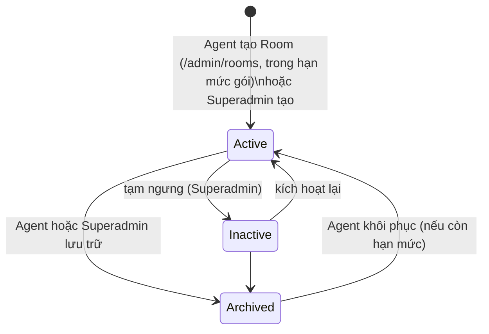
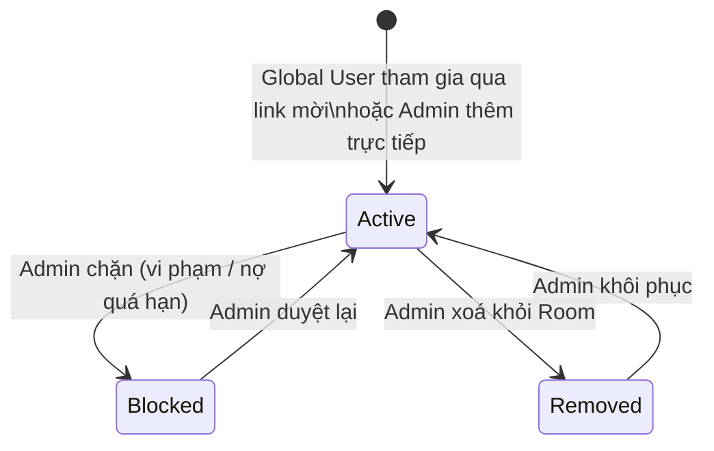
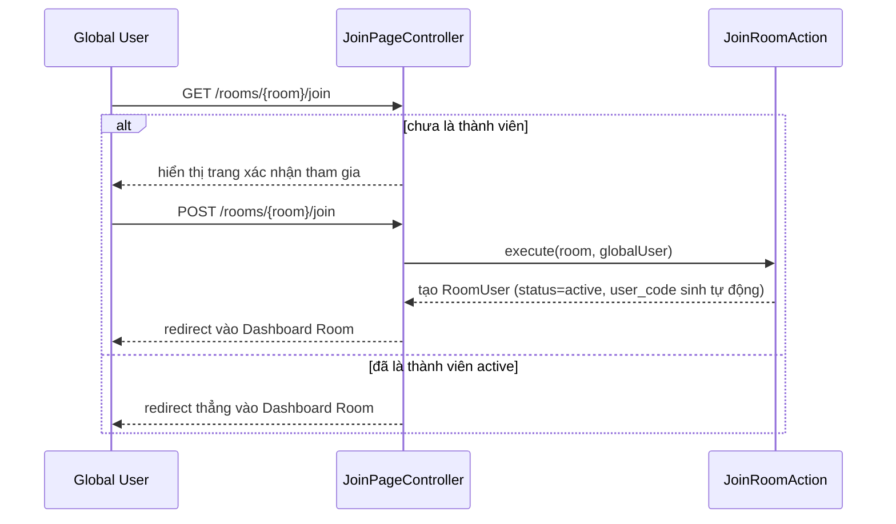

# 2. Quản lý Room & Thành viên

[← Về Tổng quan nghiệp vụ](overview.md)

**Room** là đơn vị tổ chức trung tâm của DrinkFlow — mỗi phòng ban/nhóm là một Room độc lập với thành viên, chiến dịch, công nợ và cấu hình riêng. Mỗi Room thuộc về **một Agent** (`rooms.owner_admin_id`).

## 2.1. Vòng đời Room

- **Agent** tự tạo, sửa, lưu trữ và khôi phục Room của mình (`Admin\RoomController` → `ManageAgentRoomAction`). Số Room `Active` + `Inactive` bị giới hạn bởi gói dịch vụ (`RoomQuotaService`, `room_limit_snapshot` của thuê bao đang hiệu lực); Room `Archived` không tính vào hạn mức, nên khôi phục Room cũng phải còn chỗ trống.
- **Superadmin** tạo/sửa/đổi trạng thái/xoá mọi Room (`Superadmin\RoomController`, `ManageRoomAction`) theo permission `room.manage`.
- Chỉ Room `Active` mới vào được khu vực quản trị (`admin.room`) và được các lệnh nền (thống kê, nhắc nợ, thông báo) xử lý.
- Agent có thể thêm Admin khác làm **cộng tác viên** của Room (`admin_rooms`); Superadmin cũng gán được qua `PUT /superadmin/admins/{admin}/rooms`.

## 2.2. Vòng đời thành viên (RoomUser)

Điểm quan trọng: **`RoomUserStatus` độc lập với `GlobalUserStatus`** — bị `Blocked` tại 1 Room không ảnh hưởng quyền truy cập các Room khác hay Cổng thông tin cá nhân `/me` của Global User đó (`JoinRoomAction`, `SetRoomUserStatusAction`). Ngược lại, Global User bị khoá/xoá thì không dùng được Room nào.

## 2.3. Luồng tham gia Room

Room có thể giới hạn truy cập theo **allowlist/blocklist IP** (cấu hình Room, kiểm tra ở `RoomAccessPolicy`) — IP người dùng phải được nhận đúng, xem [`documents/deploy/trusted-proxies.md`](../deploy/trusted-proxies.md).

Mỗi `RoomUser` được cấp một **`user_code`** ngẫu nhiên — dùng làm định danh khi đặt hộ ([bài 4](04-dat-mon-gio-hang.md)), làm nội dung chuyển khoản "thanh toán tất cả" ([bài 7](07-thanh-toan-cong-no.md)) và hiển thị trong bảng đối soát thay vì lộ email.

## 2.4. Thiết bị tin cậy (Device Trust)

Mỗi lần đăng nhập trên thiết bị mới có thể tạo một bản ghi `RoomUserDevice` gắn với `RoomUser` cụ thể (không phải Global User) — cho phép bỏ qua xác thực lại trong một khoảng thời gian. Admin có thể **thu hồi** từng thiết bị (`admin.room-user-devices.revoke`) khi nghi ngờ mất máy — xem chi tiết ở [bài 10](10-bao-mat-thiet-bi-audit.md).

## Tham chiếu mã nguồn

`App\Models\Room`, `App\Models\RoomUser`, `App\Models\RoomUserDevice` · `App\Enums\RoomStatus`, `RoomUserStatus` · `App\Policies\RoomPolicy` · `App\Services\Room\RoomQuotaService`, `RoomAccessPolicy` · `App\Actions\Room\ManageAgentRoomAction` · `App\Actions\User\JoinRoomAction`, `SetRoomUserStatusAction`, `RestoreRoomUserAction`, `AdminAddRoomUserAction` · `App\Actions\Superadmin\ManageRoomAction` · `App\Events\RoomMembershipUpdated`.
