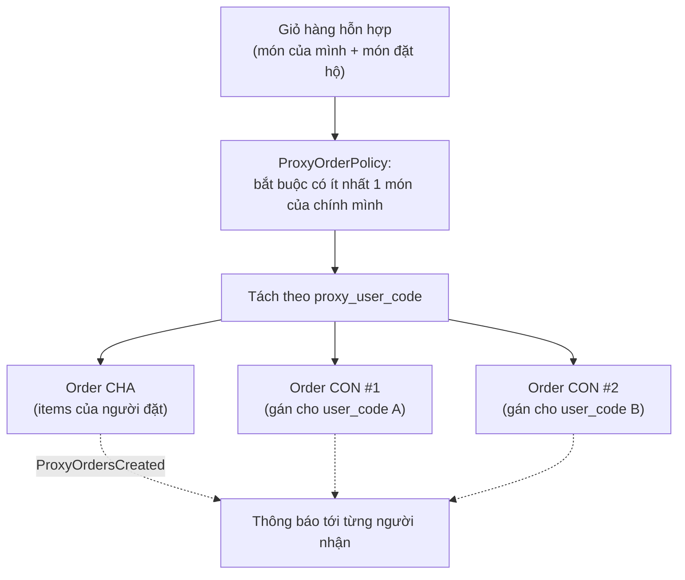
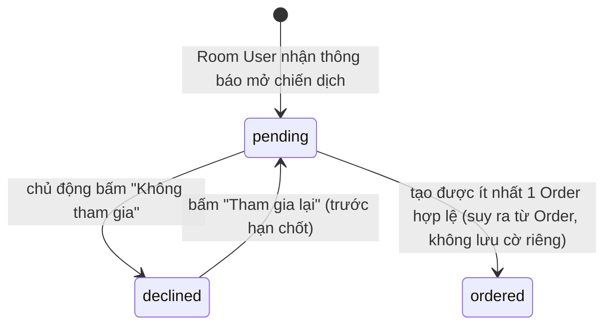

# 4. Đặt món & Giỏ hàng

[← Về Tổng quan nghiệp vụ](overview.md)

Nghiệp vụ đặt món xử lý tại `CreateOrderAction`, với ba cách đặt (`OrderPlacementType`):

| Kiểu | Action | Ai thao tác |
| --- | --- | --- |
| `self` | `CreateOrderAction` | Thành viên đặt cho chính mình |
| `proxy` | `CreateProxyOrdersAction` | Thành viên đặt kèm món cho đồng nghiệp (mục 4.2) |
| `admin` | `PlaceOrderOnBehalfAction` | Admin của Room đặt thay một thành viên; Order đứng tên thành viên, áp dụng cùng quy tắc giá/tài trợ/hạn mức nợ, ghi thêm Admin đã đặt + Audit Log. Vẫn đặt được khi chiến dịch đang **khoá nhận đơn** |

## 4.1. Điều kiện để tạo được Order

`CreateOrderAction::execute()` kiểm tra tuần tự:

1. Campaign thuộc đúng Room của Room User (`campaign.room_id === roomUser.room_id`).
2. Campaign **nhận đơn**: `Campaign::isOrderable()` (`Active`, chưa quá `deadline`, **không bị khoá nhận đơn**); riêng Admin đặt hộ dùng `isOpenForOrders()` (bỏ qua khoá).
3. `RoomUser.status === Active` **và** `GlobalUser.status === Active` — bị chặn ở 1 trong 2 cấp đều không đặt được.
4. Danh sách `items` hợp lệ (không rỗng, trừ trường hợp tạo Order rỗng làm Parent cho đặt hộ); giá tính lại ở `OrderPricingService::priceLines()`.
5. **Hạn mức nợ** của Room (nếu bật): tổng nợ đang dùng + giá trị đơn mới không được vượt trần (`OrderPricingService::enforceDebtPolicy()`).

Toàn bộ được bọc trong `DB::transaction` với `lockForUpdate()` trên Campaign và Room (và RoomUser khi kiểm tra hạn mức nợ) để tránh race-condition khi nhiều người đặt cùng lúc — quan trọng với mã đơn `ORD{room_id}-YYYYMMDD-{số thứ tự}` đánh theo ngày.

## 4.2. Đặt hộ (Proxy Order) — mô hình Parent/Child

Mỗi người nhận (`proxy_user_code`) phải là một `RoomUser` **đang hoạt động** trong cùng Room; không cho phép tự đặt hộ chính mình. Mỗi nhóm món theo mã người nhận trở thành **một Order con độc lập** đứng tên người nhận đó — không gộp chung vào Order của người đặt.

## 4.3. Theo dõi mức độ tham gia (`CampaignParticipant`)

Đây là bảng phụ trợ giúp "Final Summary" khi đóng chiến dịch chính xác, tách biệt với việc có Order hay không:

> Chỉ 2 trạng thái được lưu tường minh trong CSDL: `pending` và `declined` (`CampaignParticipant::STATUS_PENDING`, `STATUS_DECLINED`). Trạng thái **"đã đặt" (ordered) là suy luận** từ việc Room User đó có Order thuộc campaign, không phải một giá trị `status` riêng — và **"chưa phản hồi" (No Action/Unresponsive)** là phần bù: đã nhận thông báo nhưng không `declined` và không có Order.

## 4.4. Tuỳ chỉnh món & Giỏ hàng phía client

Giỏ hàng (size, topping, số lượng, ghi chú) được giữ ở phía client cho tới khi checkout; server chỉ nhận payload cuối và **luôn tính lại giá từ `CampaignItem`/`CampaignItemSize`/`CampaignItemTopping` trong CSDL** (`OrderPricingService`) — không tin tưởng giá client gửi lên, chống gian lận giá.

### Món "trả riêng"

Một dòng món có thể được đánh dấu **trả riêng** (`order_items.is_self_paid`): dòng đó **không bao giờ được tài trợ**, người đặt tự trả kể cả khi chiến dịch được tài trợ toàn bộ. Phần phí ship/giảm giá của dòng trả riêng tính theo `Campaign.self_paid_price_basis` (`original` hoặc `campaign_prorated`) — xem [bài 6](06-chinh-sach-tai-tro.md).

## Tham chiếu mã nguồn

`App\Actions\Order\CreateOrderAction`, `CreateProxyOrdersAction`, `PlaceOrderOnBehalfAction` · `App\Services\Order\OrderPricingService`, `ProxyOrderPolicy` · `App\Enums\OrderPlacementType` · `App\Models\CampaignParticipant` · `App\Actions\Campaign\DeclineCampaignAction`, `RejoinCampaignAction` · `App\Events\OrderCreated`, `ProxyOrdersCreated` · Xem thao tác UI ở [Hướng dẫn User – bài 3](../../src/public/guide-content/user/03-dat-mon-chien-dich.md).
