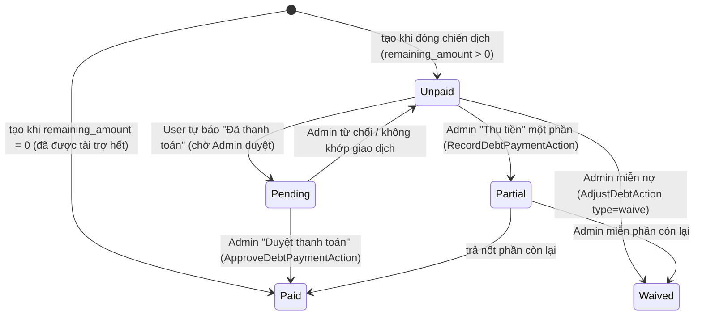
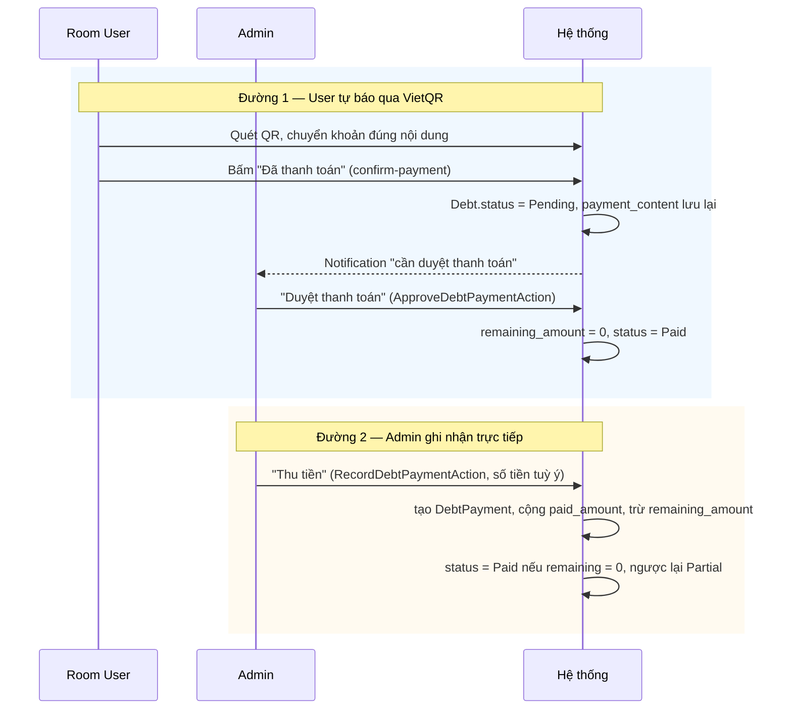
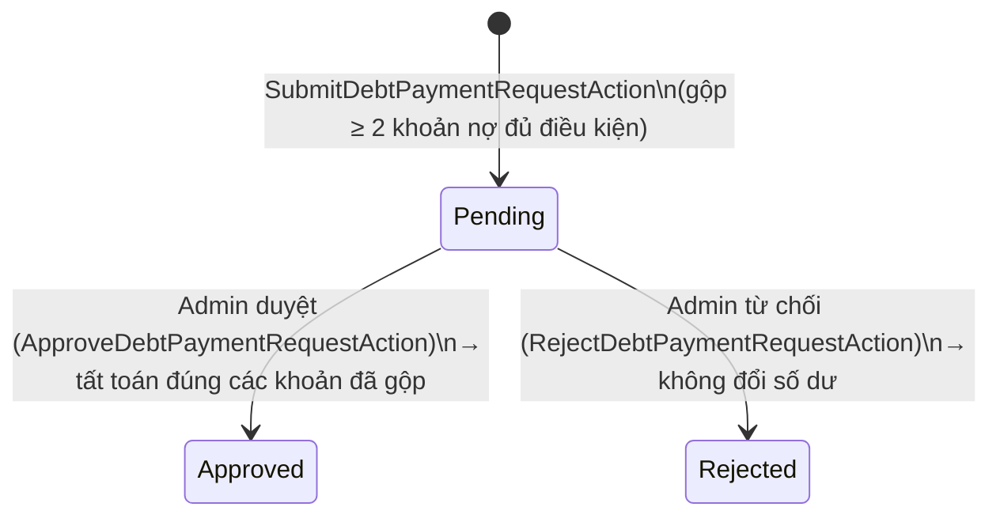

# 7. Thanh toán & Công nợ (Debt)

[← Về Tổng quan nghiệp vụ](overview.md)

Công nợ (`Debt`) phát sinh khi [đóng chiến dịch](03-chien-dich-gom-don.md) (xem công thức ở [bài 6](06-chinh-sach-tai-tro.md)) — chủ nợ (`debtor`) có thể là **thành viên thường** hoặc **Sponsor**, dùng chung một bảng `debts` (`debtor_type`).

## 7.1. Vòng đời `DebtStatus`

## 7.2. Hai đường dẫn tới "Đã thanh toán"

Đường 1 áp dụng cho **một** khoản nợ (`ConfirmDebtPaymentAction`). Muốn trả nhiều khoản một lần, dùng yêu cầu thanh toán gộp (mục 7.2.1).

### 7.2.1. Yêu cầu thanh toán gộp (Consolidated payment request)

- Yêu cầu là một dòng `debts` **cha**; các khoản nợ được gộp là dòng con. Hai trạng thái `DebtStatus::Approved` / `Rejected` **chỉ** dùng cho dòng cha này, không bao giờ cho nợ chiến dịch.
- Số tiền luôn tính lại từ các khoản nợ bị khoá trong transaction, không tin số trình duyệt gửi; dòng RoomUser được khoá trước nên bấm đúp/2 tab không tạo 2 yêu cầu.
- Khi duyệt, nếu các khoản đã gộp thay đổi so với lúc gửi thì từ chối duyệt; mỗi khoản con được ghi nhận thanh toán và đánh dấu các Order tương ứng đã trả.

### 7.2.2. Cơ chế "Thanh toán tất cả" (Pay-all) khi duyệt từng khoản

Nếu `payment_content` của một khoản nợ **trùng khớp chính xác** `user_code` của thành viên đó, `ApproveDebtPaymentAction` hiểu đây là **một lần chuyển khoản gộp cho mọi khoản đang `Pending`** của người đó trong Room và duyệt đồng loạt.

### 7.2.3. Tự đối soát qua ngân hàng (SePay)

Chi tiết kết nối, trạng thái giao dịch và quỹ phòng: [bài 13](13-dong-bo-ngan-hang-quy-phong.md).

Room có thể kết nối tài khoản ngân hàng qua SePay (`RoomBankIntegrationService`, webhook `POST /webhooks/bank/{provider}/{token}`). `BankReconciliationService` **chỉ tự tất toán khi khớp chính xác**:

- nội dung chuyển khoản chứa mã của **đúng một** khoản nợ còn dư và số tiền bằng số dư khoản đó; hoặc
- nội dung mang mã thành viên (`TV{id}`, QR "thanh toán tất cả") và số tiền bằng yêu cầu thanh toán gộp đang chờ, hoặc bằng tổng các khoản nợ phải trả của thành viên.

Mọi giao dịch khác ở trạng thái `unmatched` để Admin gán tay vào một khoản nợ hoặc bỏ qua. Mỗi giao dịch của nhà cung cấp chỉ được lưu một lần (unique index), nên webhook gửi lại không tất toán hai lần.

### 7.2.4. Hạn mức nợ cá nhân

Cấu hình Room `personal_debt_ceiling` + `auto_lock_on_debt_limit` (`DebtCreditService`): khi bật, thành viên không đặt được đơn mới nếu tổng nợ đang dùng + giá trị đơn vượt trần ([bài 4](04-dat-mon-gio-hang.md)).

## 7.3. Điều chỉnh thủ công (`DebtAdjustmentType`)

| Loại | Công thức trên `remaining_amount` | Dùng khi |
| --- | --- | --- |
| `Increase` | `+amount` | Phát sinh thêm chi phí sau khi đã chốt nợ |
| `Decrease` | `−amount` | Giảm nợ do sai lệch nhỏ |
| `Waive` | `= 0` (miễn toàn bộ phần còn lại) | Miễn nợ (ví dụ sự cố từ phía Room) |
| `Correction` | `= amount` (đặt lại đúng bằng giá trị mới) | Sửa sai số nhập liệu |

Mọi điều chỉnh đều tạo một bản ghi `DebtAdjustment` (lưu vết before/after + lý do) và không cho phép kết quả âm.

## 7.4. Các khái niệm liên quan

- **`PaymentMethod`**: `Cash`, `Transfer`, `Qr`, `VietQr`, `RoomFund` — cách một `DebtPayment`/`Order` được thanh toán. `RoomFund` trừ vào **quỹ phòng** (`RoomFundTransactionType::DebtPayment`).
- **`PaymentStatus`** (`Unpaid`/`Pending`/`Paid`): trạng thái thanh toán ở cấp **Order** ([bài 5](05-van-hanh-don-hang.md)); khi một khoản nợ được tất toán, các Order tương ứng được đánh dấu đã trả.
- **`BillSplitMethod`** (`ByOrder`/`SponsorFirst`/`Equal`/`FlatPrice`/`Custom`): quy tắc `SplitCampaignBillAction` dùng khi cần chia lại phí ship/giảm giá sau khi Order đã tồn tại.

## Tham chiếu mã nguồn

`App\Models\Debt`, `DebtPayment`, `DebtAdjustment` · `App\Enums\DebtStatus`, `DebtAdjustmentType`, `PaymentStatus`, `PaymentMethod`, `BillSplitMethod` · `App\Actions\Debt\*` (gồm `SubmitDebtPaymentRequestAction`, `ApproveDebtPaymentRequestAction`, `RejectDebtPaymentRequestAction`) · `App\Services\Debt\DebtSettlementService`, `DebtReminderService`, `DebtCreditService` · `App\Services\BankSync\BankReconciliationService` · lệnh nhắc nợ `drinkflow:remind-debts` · Xem thao tác UI ở [Hướng dẫn Admin – bài 6](../../src/public/guide-content/admin/06-quan-ly-cong-no.md) và [Hướng dẫn User – bài 5](../../src/public/guide-content/user/05-thanh-toan-cong-no.md).
