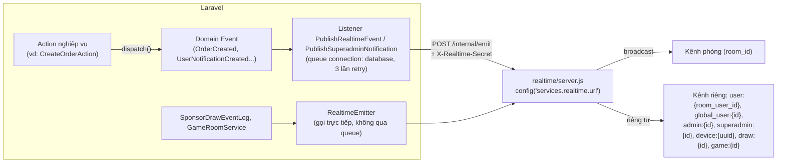

# 8. Thông báo & Realtime

[← Về Tổng quan nghiệp vụ](overview.md)

DrinkFlow có ba đường đưa tin, thường chạy song song:

1. **Notification lưu trữ** — bản ghi trong CSDL, xem lại được ở Trung tâm thông báo (`user_notifications`, `admin_notifications`, `superadmin_notifications`).
2. **Realtime** — đẩy tức thời qua Socket.IO, không lưu trữ.
3. **Kênh ngoài (gateway)** — Slack / Telegram / Chatwork / Webhook mà Room hoặc nền tảng đã cấu hình.

## 8.1. Kiến trúc realtime — Laravel → Node.js Socket.IO

- Laravel **không** tự chạy Socket.IO — nó gọi service Node.js trong thư mục `realtime/` qua HTTP nội bộ có secret riêng. Gateway chỉ nhận một danh sách tên sự kiện cố định (`realtime/server.js`).
- Listener chạy trên **queue connection `database`** (bảng `jobs`), retry theo `backoff = [1, 5, 15]` giây. Production **phải** có worker `queue:work database`, nếu không sự kiện realtime không bao giờ được gửi (xem [`documents/deploy/standalone-vps-deployment.md`](../deploy/standalone-vps-deployment.md), mục 6.2).
- **Sự kiện riêng tư** (thông báo, thay đổi membership...) **không** phát lên kênh phòng — nếu phát theo Room, mọi thành viên sẽ nhận được thông báo của người khác. Gateway từ chối sự kiện riêng tư không kèm kênh đích.

## 8.2. Danh sách sự kiện realtime

| Nguồn | Tên sự kiện Socket | Kênh nhận |
| --- | --- | --- |
| `OrderCreated` | `order.created` | Phòng |
| `OrderUpdated` | `order.updated` (kèm `previous_status`) | Phòng |
| `OrderDeleted` | `order.deleted` | Phòng + `user:{room_user_id}` |
| `CampaignCreated` / `Updated` / `Closed` / `Cancelled` / `Delivering` | `campaign.*` tương ứng | Phòng |
| `RoomRealtimeEvent` (tên do nơi gọi chỉ định) | `order.payment_submitted`, `debt.payment_submitted`, `debt.payment_approved`, `debt.payment_rejected`, `campaign.participant.declined`, `campaign.participant.rejoined`, `campaign.updated` | Phòng |
| `UserNotificationCreated` | `notification.created` | **Chỉ** `global_user:{id}` |
| `AdminNotificationCreated` | `admin.notification.created` | **Chỉ** `admin:{id}` |
| `SuperadminNotificationCreated` | `superadmin.notification.created` | **Chỉ** `superadmin:{id}` |
| `RoomMembershipUpdated` | `room.membership.updated` | `global_user:{id}` |
| `ForceReloadRequested` | `session.force_reload` | `device:{uuid}` hoặc `global_user:{id}` |
| `MaintenanceStateChanged` | `system.maintenance` | Mọi kết nối (broadcast toàn cục) |
| `SponsorDrawEventLog` (RealtimeEmitter) | `sponsor_draw.event` | `draw:{session_id}` |
| `GameRoomService` (RealtimeEmitter) | `game_room.status_changed` | `game:{game_room_id}` |

## 8.3. Notification lưu trữ (`NotificationType`)

`App\Enums\NotificationType` định nghĩa các loại thông báo lưu bền vững, nhóm theo domain:

- **Chiến dịch**: `campaign.created/updated/closed/cancelled/delivering`, `campaign.deadline_reminder` (lệnh `drinkflow:remind-campaign-deadlines`)
- **Đơn hàng**: `order.created/updated/status/deleted`, `order.proxy_received` (báo người được đặt hộ)
- **Thanh toán/Nợ**: `payment.reminder/due/confirmed`, `debt.reminder/payment_approved/updated/adjusted`
- **Bảo mật/Thiết bị**: `device.new`, `security.alert`
- **Gắn kết thành viên**: `birthday.today`, `occasion.*` (năm mới, Tết, 8/3, 20/10, 19/11, Giáng sinh), `recap.year` (tổng kết năm), `sponsor.honors` (Top 3 nhà tài trợ tháng trước)
- **Khác**: `room.invite`, `admin.broadcast` (thông báo hàng loạt từ Admin), `notification.test` (test kênh)

> Một số nơi vẫn ghi `type` bằng chuỗi chưa có trong enum (ví dụ `order.price_adjusted`, `order.payment_submitted`). Khi thêm loại mới, khai báo case trong `NotificationType` và icon trong `NotificationPresentationService`.

Gửi cho cả Room dùng `UserNotificationService::toRoom()` (queue job `SendRoomNotificationJob`, bulk insert — **không** đẩy realtime từng người); gửi từng người dùng `toRoomUser()`/`toGlobalUser()` (có đẩy realtime qua `UserNotificationCreated`).

## 8.4. Kênh ngoài (Slack / Telegram / Chatwork / Webhook)

- **Kênh của Room** (`NotificationChannel`, Admin cấu hình — [Hướng dẫn Admin – bài 9](../../src/public/guide-content/admin/09-kenh-thong-bao-broadcast.md)): `RoomNotificationChannelDispatcher::dispatch()` gửi cho mọi kênh đang bật; lỗi từng kênh chỉ ghi log, không làm hỏng luồng chính. Cấu hình kênh được **mã hoá bằng `APP_KEY`**.
- **Kênh của nền tảng** (`SystemNotificationChannel`, Superadmin cấu hình): `SystemNotificationChannelDispatcher`.
- Slack/Webhook chỉ nhận URL HTTPS công khai (Slack: `hooks.slack.com`).

Các luồng gửi đủ ba đường (lưu trữ + realtime + kênh ngoài) tiêu biểu: mở/gửi lại chiến dịch, nhắc nợ, sinh nhật, dịp lễ, tổng kết năm, Top 3 nhà tài trợ tháng.

## Tham chiếu mã nguồn

`App\Events\*` (16 event) · `App\Listeners\PublishRealtimeEvent`, `PublishSuperadminNotification` và các listener `Notify*`, `CreateOrder*Notification` · `App\Services\Realtime\RealtimeEmitter` · `App\Enums\NotificationType` · `App\Services\Notification\UserNotificationService`, `AdminNotificationService`, `SuperadminNotificationService`, `RoomNotificationChannelDispatcher`, `SystemNotificationChannelDispatcher`, `NotificationPresentationService` · `realtime/server.js`.
