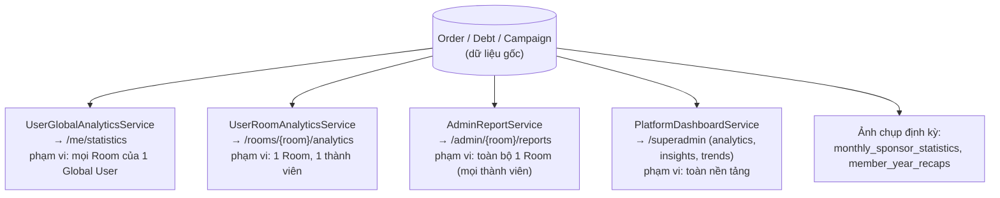

# 9. Báo cáo & Thống kê

[← Về Tổng quan nghiệp vụ](overview.md)

Không có một "module Analytics" tập trung duy nhất — mỗi actor có **service thống kê riêng**, đọc từ cùng nguồn dữ liệu Order/Debt/Campaign nhưng phạm vi khác nhau.

## 9.1. Khoảng thời gian chuẩn hoá (`AnalyticsPeriod`)

`Week` / `Month` / `Quarter` / `Year` — hiện **chỉ** `UserRoomAnalyticsService` dùng enum này; các service còn lại tự định nghĩa bộ lọc thời gian (tháng/năm, khoảng ngày). Khi thêm bộ lọc mới, nên dùng lại enum thay vì tạo thêm kiểu khác.

Mọi mốc thời gian lưu ở **UTC** (`config/app.php`); khi nhóm theo ngày/giờ để hiển thị (ví dụ heatmap giờ cao điểm) dùng `APP_DISPLAY_TIMEZONE` hoặc timezone của Room.

## 9.2. Phạm vi dữ liệu từng service

| Service | Route sử dụng | Tính theo |
| --- | --- | --- |
| `UserGlobalAnalyticsService` | `user.me.statistics` | Tất cả Order của 1 Global User, gộp qua mọi Room họ tham gia |
| `UserRoomAnalyticsService` | `user.analytics.room` | Order của 1 Room User trong đúng 1 Room |
| `AdminReportService` | `admin.reports.page` | Toàn bộ Order/Debt/Campaign của 1 Room (mọi thành viên), có thêm góc nhìn theo Sponsor và tab **Huy hiệu** (Top 3 nhà tài trợ từng tháng trong năm) |
| `PlatformDashboardService` | `superadmin.dashboard`, `superadmin.dashboard.analytics/insights/trends` | Toàn nền tảng; số liệu hiển thị theo permission của Superadmin |
| `BillingController::revenue` | `superadmin.billing.revenue` | Doanh thu nền tảng từ hoá đơn của Agent (permission `revenue.view`) |

Các trục chung: **tổng đơn**, **tổng chi tiêu thực trả**, **tổng được tài trợ**, **món/quán phổ biến nhất**; Admin có thêm **tỉ lệ tham gia theo từng chiến dịch** (dựa trên `CampaignParticipant`, xem [bài 4](04-dat-mon-gio-hang.md)) và **công nợ theo từng thành viên** (dựa trên `Debt`, xem [bài 7](07-thanh-toan-cong-no.md)).

## 9.3. Số liệu tính trước (snapshot)

| Bảng | Tạo bởi | Dùng cho |
| --- | --- | --- |
| `monthly_sponsor_statistics` | `drinkflow:calculate-monthly-sponsors` (00:15 UTC ngày 1) hoặc nút "Thống kê lại" của Admin | Bục vinh danh Top 3 tháng trước, huy hiệu cạnh tên, trang Thành tích, tab Huy hiệu của báo cáo |
| `member_year_recaps` | `drinkflow:build-year-recaps` (mùa tổng kết 15/12–31/1) | Trang tổng kết năm của thành viên |

Các bảng này chỉ thay đổi khi được tính lại, nên số liệu có thể lệch với dữ liệu gốc cho tới lần tính kế tiếp.

## 9.4. Xuất dữ liệu

Xuất Excel/CSV (`user.me.statistics.export`, `user.me.payments.export`, `admin.reports.export`, `admin.debts.export`) luôn tính lại trực tiếp từ CSDL tại thời điểm bấm nút, không dùng cache.

## Tham chiếu mã nguồn

`App\Services\Analytics\UserGlobalAnalyticsService`, `UserRoomAnalyticsService` · `App\Services\Admin\AdminReportService` · `App\Services\Dashboard\PlatformDashboardService` · `App\Services\Reporting\MonthlySponsorStatisticsService`, `YearRecapService` · `App\Enums\AnalyticsPeriod` · Xem thao tác UI ở [Hướng dẫn User – bài 6](../../src/public/guide-content/user/06-thong-ke-chi-tieu.md) và [Hướng dẫn Admin – bài 10](../../src/public/guide-content/admin/10-bao-cao-thong-ke.md).
