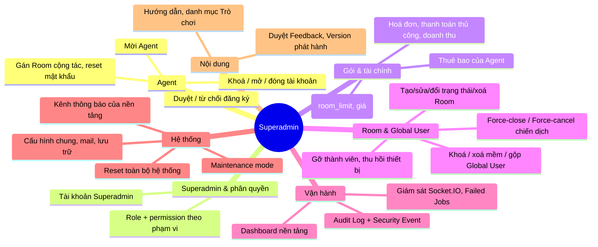
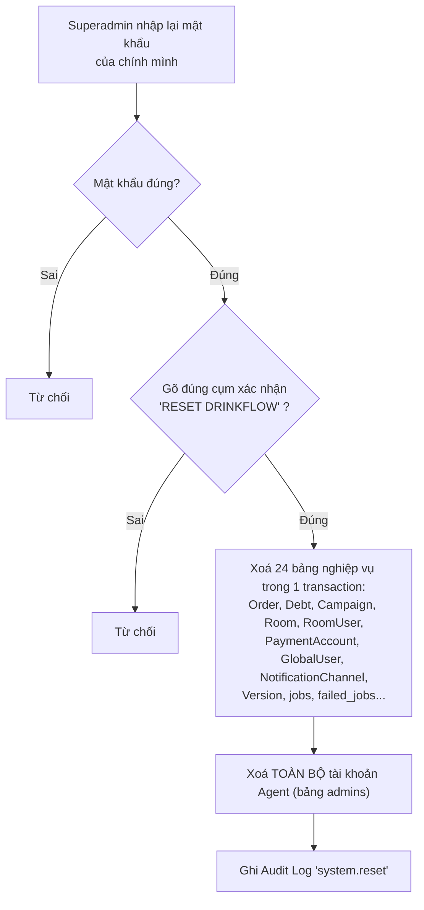

# 11. Quản trị nền tảng (Superadmin)

[← Về Tổng quan nghiệp vụ](overview.md)

Superadmin là tài khoản của **bảng và guard riêng** (`App\Models\Superadmin`, guard `superadmin`), không phải một vai trò của Admin. Mỗi route `/superadmin/*` (`routes/superadmin.php`) yêu cầu một permission cụ thể qua middleware `permission:<key>`; quyền được gán qua `SuperadminRole` (role mặc định `full` = mọi quyền) và có phạm vi (`PermissionScope`). Superadmin **không** vận hành chiến dịch/đơn/nợ hằng ngày của Room — việc đó thuộc Agent ([bài 1](01-xac-thuc-phan-quyen.md)).

Hướng dẫn thao tác: [`src/resources/guide-content/superadmin/`](../../src/resources/guide-content/superadmin/README.md).

## 11.1. Bản đồ chức năng

## 11.2. Gán Room cho Agent

Quyền vào Room của một Agent đến từ **hai nguồn** (`RoomPolicy::operate`): Agent là **chủ sở hữu** (`rooms.owner_admin_id`, tự tạo trong hạn mức gói) **hoặc** là **cộng tác viên** trong bảng `admin_rooms`. Superadmin chỉnh danh sách cộng tác qua `PUT /superadmin/admins/{admin}/rooms` (`ManageAdminAction`, permission `agent.manage`).

## 11.3. Gộp tài khoản Global User trùng lặp

Dùng khi một nhân sự vô tình tạo 2 danh tính (ví dụ đăng nhập bằng 2 domain email khác nhau). `MergeGlobalUsersAction`:

1. Từ chối gộp một tài khoản vào chính nó.
2. Từ chối nếu `source` và `target` cùng là thành viên của **một Room nào đó** (xung đột membership — cần xử lý thủ công trước).
3. Từ chối nếu 2 tài khoản xung đột danh tính OAuth.
4. Chuyển toàn bộ `OAuthIdentity` và `RoomUser` từ `source` sang `target`, sau đó **xoá vĩnh viễn** `source`.
5. Ghi `AuditLog` sự kiện `global_user.merged`.

Khác với gộp, **xoá** Global User (`DeleteGlobalUserAction`) chỉ đặt trạng thái `Deleted` (xoá mềm), giữ nguyên lịch sử đơn/nợ.

## 11.4. Reset toàn bộ hệ thống — thao tác không thể hoàn tác

- Yêu cầu permission `settings.manage`. Tài khoản **Superadmin** (bảng riêng), Audit Log, Security Event và các bảng không có trong danh sách (`ResetSystemAction`) được **giữ lại**.
- Danh sách bảng được viết cứng trong `ResetSystemAction`; các module thêm sau (thuê bao, trò chơi, thống kê nhà tài trợ, tổng kết năm...) phụ thuộc vào ràng buộc khoá ngoại `cascadeOnDelete` để bị xoá theo. Khi thêm bảng mới gắn với Room/Agent, kiểm tra lại thao tác này.
- ⚠️ **Hạn chế hiện tại**: `admin_invoices` và `admin_payments` khoá ngoại `admin_id` với `restrictOnDelete` và không có trong danh sách xoá. Khi đã có Agent phát sinh hoá đơn, bước xoá Agent bị MySQL từ chối và **toàn bộ reset bị rollback**.
- Dành cho môi trường thử nghiệm/demo, không phải thao tác vận hành; không có cơ chế khôi phục trong ứng dụng (chỉ khôi phục từ bản sao lưu DB).

## 11.5. Vận hành nền

- **Queue thất bại** (`/superadmin/queue/failed`, permission `queue.view`/`queue.manage`): xem, retry hoặc xoá hẳn (`forget`) các job lỗi — ví dụ job đẩy realtime thất bại nhiều lần.
- **Giám sát Socket** (`/superadmin/socket`): kiểm tra kết nối tới service Node.js realtime ([bài 8](08-thong-bao-realtime.md)); lý do lỗi phân loại theo `SocketHealthReason`.
- **Chế độ bảo trì** (`/superadmin/system/maintenance`): bật/tắt chặn truy cập tạm thời; phát sự kiện `system.maintenance` tới mọi kết nối.
- **Thẻ Supervisor** trên dashboard (tuỳ chọn, `SUPERVISOR_ENABLED`): đọc trạng thái worker qua `supervisorctl status`.

## Tham chiếu mã nguồn

`routes/superadmin.php` · `App\Models\Superadmin`, `SuperadminRole`, `SuperadminPermission` · `App\Enums\Permission`, `PermissionScope`, `SuperadminStatus` · `App\Services\Authorization\PermissionCatalogService` · `App\Actions\Superadmin\ManageAdminAction`, `ManageRoomAction`, `ManageSuperadminAction`, `ManageSuperadminRoleAction`, `ReviewAgentRegistrationAction`, `InviteAgentAction`, `AgentLifecycleAction`, `MergeGlobalUsersAction`, `DeleteGlobalUserAction`, `ForceArchiveCampaignAction`, `ResetSystemAction` · Middleware `superadmin`, `permission`, `superadmin.mask`.
