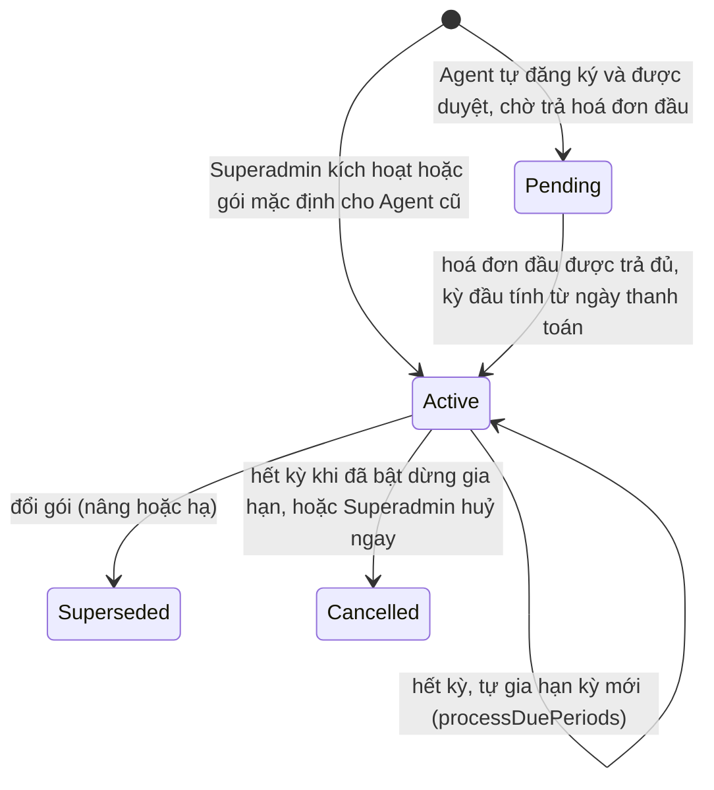
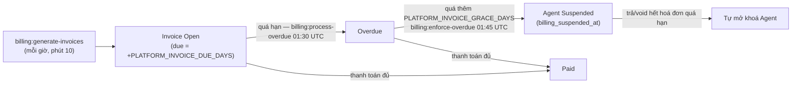

# 12. Gói dịch vụ, Thuê bao & Hoá đơn nền tảng

[← Về Tổng quan nghiệp vụ](overview.md)

DrinkFlow vận hành theo mô hình SaaS: mỗi **Agent** (`Admin`) trả phí cho nền tảng theo **gói dịch vụ** để được tạo và vận hành Room. Miền này **tách biệt hoàn toàn** với công nợ đồ uống giữa thành viên trong Room ([bài 7](07-thanh-toan-cong-no.md)).

## 12.1. Khái niệm & trạng thái

| Đối tượng | Model | Trạng thái (Enum) | Ghi chú |
| --- | --- | --- | --- |
| Gói dịch vụ | `Package` | `PackageStatus`: `Active` / `Inactive` / `Archived` | Giá tháng (`monthly_price`), số Room tối đa (`room_limit`). Superadmin quản lý (`ManagePackageAction`) |
| Thuê bao | `AdminSubscription` | `SubscriptionStatus`: `Pending` / `Active` / `Superseded` / `Expired` / `Cancelled` | Mỗi lần đổi gói tạo **dòng mới**, dòng cũ thành `Superseded` → giữ lịch sử |
| Hoá đơn | `AdminInvoice` | `InvoiceStatus`: `Open` / `Overdue` / `Paid` / `Void`; `InvoiceType`: `Subscription` / `Upgrade` | Một hoá đơn cho mỗi kỳ của thuê bao |
| Thanh toán | `AdminPayment` | `PlatformPaymentMethod`: `BankTransfer` / `Cash` / `Card` / `Online` / `Other` | Cho phép trả một phần |

**Snapshot giá & hạn mức**: khi kích hoạt, giá và số Room của gói được chép vào `price_snapshot` / `room_limit_snapshot`. Hoá đơn và hạn mức Room ([bài 2](02-quan-ly-room-thanh-vien.md)) **chỉ đọc snapshot**, nên sửa gói sau này không ảnh hưởng thuê bao đang chạy.

## 12.2. Vòng đời thuê bao

Dừng gia hạn lưu ở cờ `cancel_at_period_end`; Superadmin huỷ ngay qua `SubscriptionService::cancelNow()`. Gia hạn kỳ do `SubscriptionService::processDuePeriods()` (lệnh `subscriptions:process`) thực hiện.

> `SubscriptionStatus::Expired` có trong enum và được xử lý khi đọc (ví dụ `AgentAccessService`), nhưng hiện **không có luồng nào ghi** trạng thái này.

- **Agent tự đăng ký**: thuê bao ở `Pending`, khu vực quản trị **chỉ mở trang thanh toán** cho tới khi trả hoá đơn đầu (`PaymentRequirementService`, middleware `EnsureFirstPaymentSettled`). Khi trả đủ, kỳ đầu chạy từ ngày thanh toán và Agent nhận email báo gói đã dùng được.
- **Agent có từ trước mô hình SaaS** chưa có thuê bao: nhận gói mặc định `PLATFORM_DEFAULT_PACKAGE` (idempotent).
- **Nâng gói** (`SubscriptionUpgradeService`): phát hành hoá đơn `upgrade` = giá gói mới − phần chưa dùng của kỳ hiện tại; Agent **giữ gói cũ tới khi hoá đơn này được trả đủ**, sau đó gói mới bắt đầu và hoá đơn này trở thành hoá đơn kỳ đầu (không tính tiền 2 lần). Yêu cầu chưa trả có thể huỷ, và tự `Void` khi quá hạn (không thành nợ quá hạn). Nâng gói miễn phí được áp dụng ngay.
- **Hạ gói**: chờ hết kỳ; bị từ chối nếu Agent đang sở hữu nhiều Room hơn hạn mức của gói nhỏ.

## 12.3. Hoá đơn, quá hạn & tạm khoá

- **Idempotent**: mỗi kỳ chỉ một hoá đơn nhờ unique index `(admin_subscription_id, period_start)` — chạy lại hoặc chạy song song scheduler không bao giờ tính tiền 2 lần (`PlatformBillingService`).
- **Tự động tạm khoá** chỉ khi `PLATFORM_AUTO_SUSPEND` bật (mặc định trong `config/platform.php` là `true`). Tạm khoá do Superadmin quyết định thủ công **không** được tự mở.
- Khi tạm khoá tự động: Agent nhận email; Superadmin phụ trách và Superadmin có toàn quyền công nợ nền tảng nhận thông báo (lưu + realtime) và kênh ngoài của nền tảng (`BillingSuspensionNotifier`).
- **Room bị chặn vận hành** khi chủ sở hữu không còn `Active` hoặc thuê bao đã hết (`Expired`/`Cancelled`) mà chưa có thuê bao mới (`AgentAccessService`).
- **Nhắc gia hạn**: email một lần mỗi kỳ, khi còn ≤ `PLATFORM_RENEWAL_REMINDER_DAYS` ngày (`subscriptions:remind-renewals`, 08:00 UTC); không gửi nếu Agent đã dừng gia hạn.

## 12.4. Thanh toán hoá đơn

- **Thủ công**: Superadmin ghi nhận khoản thanh toán (toàn phần hoặc một phần) — `PlatformBillingService::recordPayment()`. Trả hết hoá đơn quá hạn cuối cùng sẽ gỡ tạm khoá tự động.
- **Online** (tuỳ chọn, `PLATFORM_PAYMENTS_ENABLED`): cổng thanh toán hosted checkout; DrinkFlow tạo link `checkout_url?invoice=…&amount=…&return_url=…&signature=HMAC-SHA256` và chỉ tin thông báo thanh toán có chữ ký hợp lệ (`PLATFORM_PAYMENTS_WEBHOOK_SECRET`) — `SignedLinkGateway`, route `payments.webhook`.
- **Hoá đơn PDF**: cùng template Blade với trang xem hoá đơn (`InvoicePdfService`, DOMPDF, không cần Chrome). Hoá đơn tiếng Nhật cần font CJK (`PDF_CJK_FONT_PATH`), thiếu font thì in nhãn tiếng Anh.

## 12.5. Doanh thu nền tảng

`PlatformRevenueService` (permission `revenue.view`): MRR, tổng phát hành, đã thu, còn nợ, theo tháng và theo gói. Mọi con số đi qua **phạm vi Agent** của Superadmin — Superadmin phạm vi `managed` không thấy tiền của Agent ngoài phân công, kể cả trong số tổng.

## Lịch chạy nền (UTC)

| Lệnh | Lịch | Việc |
| --- | --- | --- |
| `subscriptions:process` | Mỗi giờ, phút 0 | Gia hạn/kết thúc kỳ thuê bao đến hạn |
| `billing:generate-invoices` | Mỗi giờ, phút 10 | Phát hành hoá đơn kỳ hiện tại còn thiếu |
| `billing:process-overdue` | 01:30 | Chuyển hoá đơn quá hạn sang `Overdue`, void yêu cầu nâng gói quá hạn |
| `billing:enforce-overdue` | 01:45 | Tạm khoá Agent quá thời gian ân hạn (nếu bật) |
| `subscriptions:remind-renewals` | 08:00 | Email nhắc gia hạn |

## Tham chiếu mã nguồn

`App\Models\Package`, `AdminSubscription`, `AdminInvoice`, `AdminPayment` · `App\Enums\PackageStatus`, `SubscriptionStatus`, `InvoiceStatus`, `InvoiceType`, `PlatformPaymentMethod` · `App\Services\Subscription\SubscriptionService`, `SubscriptionUpgradeService`, `SubscriptionRenewalReminderService`, `AgentAccessService` · `App\Services\Billing\PlatformBillingService`, `BillingEnforcementService`, `BillingSuspensionNotifier`, `PaymentRequirementService`, `InvoicePdfService`, `PlatformRevenueService`, `Gateway\SignedLinkGateway` · `App\Actions\Package\ManagePackageAction` · `config/platform.php` · Hướng dẫn: [Superadmin – Gói dịch vụ & thuê bao](../../src/resources/guide-content/superadmin/03-goi-dich-vu-thue-bao.md), [Tài chính nền tảng](../../src/resources/guide-content/superadmin/04-tai-chinh-nen-tang.md).
