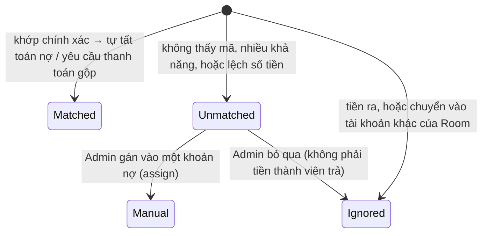

# 13. Đồng bộ ngân hàng & Quỹ phòng

[← Về Tổng quan nghiệp vụ](overview.md)

Hai công cụ giúp Admin thu công nợ ([bài 7](07-thanh-toan-cong-no.md)) mà không phải đối chiếu tay: **tự đối soát chuyển khoản** qua dịch vụ đọc biến động số dư, và **quỹ phòng** để trả nợ hộ hoặc chi tiêu chung.

## 13.1. Đồng bộ ngân hàng (Bank feed)

### Kết nối

- Mỗi Room có tối đa một kết nối `RoomBankIntegration`; nhà cung cấp hiện có: **SePay** (`BankProvider::SePay`).
- Admin bật/tắt, nhập API key của SePay và lấy **URL webhook bí mật** (`/webhooks/bank/{provider}/{token}`, token sinh ngẫu nhiên) tại trang `admin.bank-sync.index` (`RoomBankIntegrationService`). Không bật được khi chưa có API key; để trống ô API key khi lưu thì giữ key cũ.
- SePay gửi mỗi giao dịch một request JSON, header `Authorization: Apikey {API_KEY}`; DrinkFlow từ chối nếu key không khớp (`SePayWebhookParser`). Phản hồi 2xx `{"success": true}` để SePay ngừng gửi lại. Route có rate limit `throttle:120,1`.

### Vòng đời giao dịch (`BankTransactionStatus`)

### Quy tắc tự khớp (`BankReconciliationService`)

Chỉ tự tất toán khi **khớp chính xác**:

1. Nội dung chuyển khoản chứa mã của **đúng một** khoản nợ đang phải trả (so sánh chỉ trên chữ và số, vì ngân hàng hay bỏ dấu cách/ký tự đặc biệt) **và** số tiền bằng số dư khoản đó; hoặc
2. Nội dung mang mã thành viên (`TV{id}`, dùng cho QR "thanh toán tất cả") **và** số tiền bằng yêu cầu thanh toán gộp đang chờ của thành viên, hoặc bằng tổng các khoản nợ phải trả.

Thêm các điều kiện an toàn:

- Khoản nợ đã nằm trong một yêu cầu thanh toán gộp đang chờ/đã duyệt thì không được tự tất toán riêng lẻ.
- Tài khoản nhận phải là một tài khoản của Room (hoặc Room chưa khai báo tài khoản nào).
- Mỗi giao dịch của nhà cung cấp chỉ lưu **một lần** (unique index) — webhook gửi lại không tất toán hai lần.
- Việc tất toán chạy trong transaction; nếu các khoản nợ thay đổi giữa chừng, giao dịch được để lại `Unmatched` cho Admin.

### Admin xử lý giao dịch chưa khớp

- **Gán** (`assign`, `admin.bank-sync.assign`): chọn mã khoản nợ; đủ số dư thì tất toán, ít hơn thì ghi nhận thanh toán một phần.
- **Bỏ qua** (`ignore`, `admin.bank-sync.ignore`): giao dịch không phải tiền thành viên trả nợ.

## 13.2. Quỹ phòng (Room fund)

Sổ quỹ là chuỗi bút toán `RoomFundTransaction`, mỗi bút toán lưu số dư sau khi ghi (`RoomFundService`).

| Loại (`RoomFundTransactionType`) | Ai tạo | Ý nghĩa |
| --- | --- | --- |
| `Deposit` | Admin (trang Quỹ) | Nạp tiền vào quỹ (có thể gắn thành viên đóng góp) |
| `Expense` | Admin (trang Quỹ) | Chi tiêu chung từ quỹ |
| `Adjustment` | Admin (trang Quỹ) | Điều chỉnh số dư (sửa sai) |
| `DebtPayment` | Hệ thống | Trả nợ thành viên bằng quỹ: khi Admin ghi nhận thanh toán với `PaymentMethod::RoomFund` (`RecordDebtPaymentAction`) hoặc xác nhận nợ cả chiến dịch đã trả bằng quỹ (`ConfirmCampaignDebtsPaidAction`) |

Quy tắc:

- Mọi lần ghi **khoá dòng Room**, đọc số dư mới nhất rồi thêm bút toán → ghi đồng thời được tuần tự hoá.
- **Số dư không bao giờ âm**: quỹ không đủ thì cả giao dịch trả nợ bị rollback.
- Admin chỉ tạo tay được `Deposit` / `Expense` / `Adjustment` (`RoomFundTransactionType::manualValues()`).
- Trang quỹ (`admin.fund.index`) lọc theo loại, thành viên, khoảng ngày; xuất file qua `admin.fund.export`.

## Tham chiếu mã nguồn

`App\Models\RoomBankIntegration`, `BankTransaction`, `RoomFundTransaction` · `App\Enums\BankProvider`, `BankTransactionStatus`, `RoomFundTransactionType`, `PaymentMethod` · `App\Services\BankSync\RoomBankIntegrationService`, `BankReconciliationService`, `SePayWebhookParser` · `App\Services\RoomFund\RoomFundService` · `App\Http\Controllers\Public\BankWebhookController`, `App\Http\Controllers\Admin\BankSyncController`, `RoomFundController` · `App\Actions\Debt\RecordDebtPaymentAction`, `ConfirmCampaignDebtsPaidAction`.
