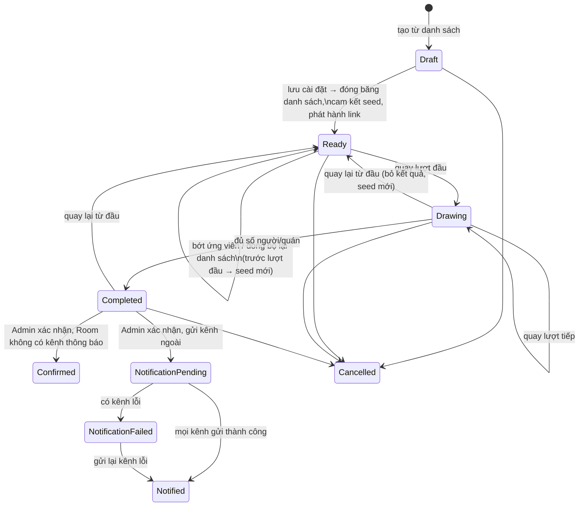
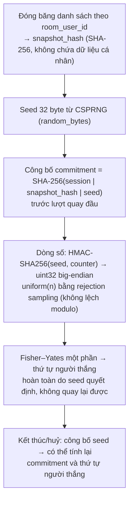

# 14. Vòng quay may mắn (Sponsor draw)

[← Về Tổng quan nghiệp vụ](overview.md)

Admin tổ chức một **phiên quay** để chọn ngẫu nhiên, có thể kiểm chứng: **người tài trợ** cho chiến dịch tiếp theo, hoặc **quán** sẽ đặt. Thành viên xem trực tiếp qua một link có thời hạn.

## 14.1. Hai loại phiên (`SponsorDrawType`)

| Loại | Danh sách ứng viên | Kết quả |
| --- | --- | --- |
| `Sponsors` | Thành viên đang hoạt động của Room (cả `RoomUser` và `GlobalUser` đều `Active`) | N người thắng; khi xác nhận có thể **tự đặt làm nhà tài trợ** (chia đều %) của một chiến dịch chưa kết thúc/chưa huỷ |
| `Shops` | Danh sách tên quán Admin nhập (gợi ý từ các quán của chiến dịch trước; bỏ trùng không phân biệt hoa thường) | Một quán; chỉ công bố |

Giới hạn: tối đa `SPONSOR_DRAW_MAX_WINNERS` (50) người thắng, `SPONSOR_DRAW_MAX_SHOPS` (100) quán; link xem hết hạn sau `SPONSOR_DRAW_LINK_TTL_MINUTES` (60) phút (`config/sponsor_draw.php`).

## 14.2. Vòng đời phiên (`SponsorDrawStatus`)

- **Backend chọn người thắng**, trình duyệt chỉ hiển thị. Admin quay **từng lượt**.
- Mọi thay đổi trạng thái chạy trong transaction giữ khoá dòng phiên; unique index ở DB chặn việc hai Admin quay trùng ứng viên hoặc vượt số lượng.
- Danh sách đã đóng băng **không đổi** sau lượt quay đầu tiên.
- Huỷ phiên chưa xác nhận: kết quả vẫn lưu, seed được công bố.
- Gửi kênh ngoài qua job `SendSponsorDrawNotification`, ghi kết quả từng kênh; "gửi lại" chỉ gửi các kênh lỗi, kênh đã thành công không gửi lần hai.

## 14.3. Cơ chế ngẫu nhiên có thể kiểm chứng (`csprng-commit-reveal-v1`)

> Hiện repo **chưa có** công cụ kiểm chứng chạy trên trình duyệt (docblock của `SponsorDrawRandomizer` nhắc tới `resources/js/sponsor-draw/verify.js` nhưng file này không tồn tại). Việc kiểm chứng làm thủ công từ bản ghi kiểm chứng của Admin theo đúng các bước trên.

> Mức đảm bảo: chứng minh seed **không bị đổi sau khi đã công bố commitment**; không chứng minh được nhà vận hành không thử nhiều seed trước khi công bố (cần randomness beacon công khai nếu muốn mạnh hơn).

**Nhật ký sự kiện** (`SponsorDrawEventLog`): chỉ ghi thêm, mỗi sự kiện có `event_hash` bao gồm hash của sự kiện trước (chuỗi hash) — sửa/xoá một sự kiện cũ sẽ làm hỏng chuỗi (`verify()`). Sự kiện được đẩy realtime tới kênh `draw:{session_id}` **sau khi commit**, đồng thời là nguồn phát lại cho người vào xem muộn.

## 14.4. Người xem

- Link `/rooms/{room}/sponsor-draws/{token}`: token lưu dạng hash + mã hoá; cấp link mới thì link cũ ngừng hoạt động ngay.
- Chỉ **thành viên đủ điều kiện** của Room mới xem được; trang công khai chỉ hiện **tên**, không lộ ID nội bộ. Admin xem được bản ghi kiểm chứng đầy đủ (snapshot có ID, seed, kết quả, chuỗi sự kiện).

## Tham chiếu mã nguồn

`App\Models\SponsorDrawSession`, `SponsorDrawEligibleUser`, `SponsorDrawResult`, `SponsorDrawEvent`, `SponsorDrawNotification` · `App\Enums\SponsorDrawStatus`, `SponsorDrawType` · `App\Services\SponsorDraw\SponsorDrawService`, `SponsorDrawRandomizer`, `SponsorDrawEventLog` · `App\Jobs\SendSponsorDrawNotification` · `App\Http\Controllers\Admin\SponsorDrawController` · `resources/js/sponsor-draw/` · `config/sponsor_draw.php` · Hướng dẫn: [Admin – Vòng quay may mắn](../../src/public/guide-content/admin/13-vong-quay-may-man.md), [User – Vòng quay may mắn](../../src/public/guide-content/user/15-vong-quay-may-man.md).
