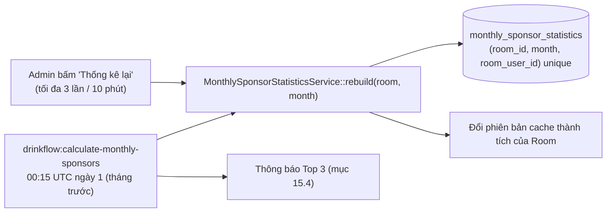

# 15. Huy hiệu Top 3 nhà tài trợ & Thành tích

[← Về Tổng quan nghiệp vụ](overview.md)

Mỗi tháng, **3 thành viên tài trợ nhiều nhất** của từng Room được vinh danh: bục vinh danh trên dashboard, huy hiệu cạnh tên, trang Thành tích của từng người và tab Huy hiệu trong báo cáo của Admin.

## 15.1. Số liệu tài trợ của một tháng

Nguồn: `SponsorLeaderboardService::build()`, cùng công thức với bảng xếp hạng nhà tài trợ của Room.

- Tính theo **tháng tạo chiến dịch** (không phải ngày đóng), chỉ chiến dịch `Active` / `Closing` / `Closed` / `Archived` (bỏ `Draft`, `Scheduled`, `Cancelled`) và chỉ Order `Completed`.
- Chiến dịch `full`: phần được tài trợ = tổng đơn trừ các dòng **trả riêng**, chia theo `sponsor_allocations` đúng như công nợ được ghi khi đóng ([bài 6](06-chinh-sach-tai-tro.md)).
- Kiểu khác: `SUM(orders.sponsor_amount)` gán cho `sponsor_name` dạng chữ tự do (phòng ban, nhà tài trợ ngoài) — **không** tính vào huy hiệu vì không gắn với thành viên.
- Chỉ giữ thành viên còn thuộc Room và có tổng tài trợ > 0.

## 15.2. Ảnh chụp tháng (`monthly_sponsor_statistics`)

- `rebuild()` khoá dòng Room (các lần chạy song song được tuần tự hoá), upsert tổng mới và **xoá** thành viên không còn tài trợ trong tháng đó.
- Lệnh chỉ xử lý Room `Active`; tham số `--month=YYYY-MM`, `--room=slug`, `--no-notify`.
- Mọi màn hình **chỉ đọc ảnh chụp**, nên số liệu chỉ đổi khi được tính lại.

## 15.3. Xếp hạng & huy hiệu

- Thứ tự: `total_sponsored` giảm dần, **hoà thì `room_user_id` nhỏ hơn đứng trước** — ổn định giữa các lần tải trang.
- Hạng 1/2/3 = Vàng/Bạc/Đồng. Chỉ tháng **đã kết thúc** được xếp hạng; tháng hiện tại hiển thị "đang diễn ra".
- Nơi hiển thị:
  - Dashboard Room (thành viên và Admin): bục Top 3 của **tháng trước** (`previousMonthHonors`).
  - Huy hiệu cạnh tên trong danh bạ, hồ sơ, danh sách đơn (`previousMonthRanks`).
  - Lịch sử huy hiệu 12 tháng gần nhất trên hồ sơ thành viên (`recentBadges`).
  - Trang **Thành tích** `/rooms/{room}/achievements`: 12 ô tháng của một năm, hạng, số tiền, vị trí, tổng huy hiệu năm (`memberYearAchievements`, cache 1 ngày, tự làm mới khi Room được tính lại).
  - Báo cáo Admin – tab **Huy hiệu**: bục từng tháng + tổng huy hiệu mỗi thành viên trong năm (`yearlyBadgeReport`).

## 15.4. Thông báo Top 3 tháng trước

Sau khi tính lại mỗi Room, lệnh `drinkflow:calculate-monthly-sponsors` gửi danh sách Top 3 (🥇🥈🥉, tên, số tiền) qua đủ ba đường ([bài 8](08-thong-bao-realtime.md)):

| Kênh | Nội dung |
| --- | --- |
| Web notification (`sponsor.honors`) | Mỗi thành viên `Active` (cả Global User `Active`) của Room nhận một thông báo, link tới dashboard Room |
| Socket | Mỗi thông báo đẩy realtime tới `global_user:{id}` |
| Kênh ngoài (gateway) | Một tin cho mọi kênh đang bật của Room |

- **Chỉ một lần cho mỗi Room/tháng**: bảng `room_sponsor_honor_notifications` có unique `(room_id, month)`; chạy lại lệnh không gửi lặp. Room không có nhà tài trợ thì không gửi.
- Nút "Thống kê lại" của Admin **không** gửi thông báo; `--no-notify` để chỉ tính lại.

## Tham chiếu mã nguồn

`App\Models\MonthlySponsorStatistic` · `App\Services\Reporting\SponsorLeaderboardService`, `MonthlySponsorStatisticsService`, `MonthlySponsorHonorNotificationService` · `App\Console\Commands\CalculateMonthlySponsors` · `App\Http\Controllers\Admin\SponsorHonorController` · `App\Http\Controllers\User\AchievementController` · `App\Enums\NotificationType::SponsorHonors` · Hướng dẫn: [Admin – Huy hiệu & thành tích](../../src/public/guide-content/admin/14-huy-hieu-thanh-tich.md), [User – Thành tích](../../src/public/guide-content/user/16-thanh-tich.md).
