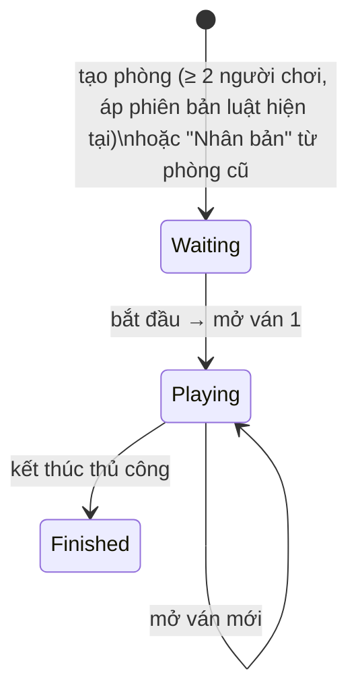
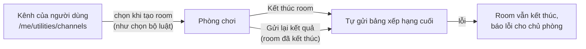

# 18. Tiện ích: Trò chơi & Kênh thông báo

[← Về Tổng quan nghiệp vụ](overview.md)

Khu **Tiện ích** (`/me/utilities`, trước đây "Trò chơi" ở `/me/games` — link cũ chuyển hướng 301) là module ghi điểm cho các trò chơi nhóm (bài, cờ...) ở Cổng cá nhân, kèm kênh thông báo riêng để gửi kết quả về nhóm chat. **Độc lập với Room đặt đồ uống**: "phòng chơi" (`GameRoom`) là khái niệm riêng, không liên quan tới `Room`, không ảnh hưởng tiền hay công nợ.

## 18.1. Danh mục trò chơi

- Superadmin quản lý danh mục (`/superadmin/games`, `GameCatalogService`; `GameSeeder` tạo sẵn danh mục mặc định).
- Trò chơi đã có phòng chơi hoặc bộ luật thì **không xoá được** (lịch sử sẽ bị xoá theo) — chỉ tắt (`is_active = false`) để ẩn khỏi danh mục.

## 18.2. Bộ luật tính điểm (rule set) có phiên bản

- Mỗi Global User tự tạo bộ luật cho từng trò chơi: danh sách mục luật, mỗi mục là số điểm cho một kiểu thắng (`GameRuleSetService`).
- **Một phiên bản không bao giờ bị sửa**: lưu bộ luật là tạo phiên bản mới. Phòng chơi giữ phiên bản đang áp dụng cho tới khi chủ phòng chủ động áp phiên bản mới (`rule-version`). Kết quả đã ghi giữ nguyên **snapshot** điểm.

## 18.3. Vòng đời phòng chơi (`GameRoomStatus`)

- Phòng `Finished` không nhận thêm kết quả, ván mới hay chỉnh sửa.
- Người chơi: thêm khi phòng chưa kết thúc; đổi tên hoặc bật/tắt (lịch sử gắn theo ID nên đi theo tên mới). Tên hiển thị **không trùng** trong phòng (không phân biệt hoa thường).
- **Chống thao tác trùng**: dòng phòng chơi bị khoá khi thao tác; mở ván mới kèm số ván client đang xem, nên bấm đúp hay 2 người cùng bấm chỉ mở một ván.
- Mọi thay đổi trạng thái/ván được đẩy realtime `game_room.status_changed` tới kênh `game:{id}` để các trang công khai đang mở tải lại.

## 18.4. Ghi kết quả & điểm

- Một **kết quả** = 1 người thắng với 1 hoặc nhiều người thua trong **ván mới nhất** của phòng `Playing`; người thắng và người thua phải là người chơi đang hoạt động, khác nhau, ít nhất 1 người thua.
- Điểm lấy từ mục luật của phiên bản phòng đang áp dụng (**không** lấy từ client) và được snapshot vào kết quả.
- Kết quả, danh sách người thua, giao dịch điểm (`GameScoreTransactionType::Award`) và Audit Log ghi trong **một transaction**, sau khi kiểm tra lại phòng vẫn đang chơi.
- **Idempotency key** (duy nhất trong phòng): gửi lại cùng một request trả về kết quả đầu tiên, không tạo trùng.
- **Huỷ kết quả** (`GameResultStatus::Voided`) phải có lý do; giao dịch điểm gốc được giữ và một giao dịch `Reversal` triệt tiêu điểm.

### Cách tính bảng xếp hạng (`GameStatisticsService`)

- **Điểm tổng bằng 0 (zero-sum)**: người thắng được điểm, người thua bị trừ chia đều (A thắng B 2 điểm → A +2, B −2). Tổng điểm của một người = tổng các giá trị đối đầu. Kết quả bị huỷ không tính.
- **Thắng/Thua**: một kết quả nhiều người thua = 1 trận thắng cho người thắng, 1 trận thua cho mỗi người thua.
- Xếp hạng: điểm giảm dần → số trận thắng giảm dần → tên A→Z. Có thêm bảng đối đầu (head-to-head) và lịch sử.

## 18.5. Link công khai `/play/{token}`

- Chủ phòng phát hành link công khai; phát hành lại thì link cũ ngừng hoạt động, có thể thu hồi.
- Người xem chọn **mình là người chơi nào**; lựa chọn lưu trong session và được "giữ chỗ" (claim token) để người khác không chọn trùng.
- Trên trang công khai, người xem **chỉ ghi được trận mình thắng** — người thắng luôn là người chơi đã chọn, không lấy từ dữ liệu gửi lên (`GamePublicAccessService`, `GameResultService`).

## 18.6. Kênh thông báo & gửi kết quả

- Mỗi Global User có **danh sách kênh riêng** (`GameNotificationChannel`: Slack / Telegram / Chatwork / Webhook), không dùng chung với kênh của Room đặt đồ uống. Phòng chơi chọn **tối đa một** kênh (`game_notification_channel_id`), đổi được cả sau khi kết thúc; "Nhân bản" giữ kênh nếu kênh còn bật.
- Cấu hình kênh **mã hoá bằng `APP_KEY`**, không trả lại trình duyệt; sửa kênh mà để trống ô bí mật thì giữ giá trị cũ. Mỗi loại kênh bắt buộc đủ thông tin; URL webhook phải là HTTPS công khai (Slack: `hooks.slack.com`).
- **Kết thúc phòng** gửi tự động bảng xếp hạng (hạng, điểm, thắng/thua) nếu kênh đang bật. Gửi lỗi **không** làm hỏng việc kết thúc phòng.
- **Gửi lại kết quả**: chỉ khi phòng `Finished` và có kênh đang bật; thành công thì cập nhật `results_notified_at` + Audit Log `game_room.results_notified`.
- Chỉ chủ kênh được xem/sửa/xoá/gửi thử/chọn kênh (`GameNotificationChannelPolicy`); xoá kênh thì phòng đang dùng tự bỏ liên kết.
- Gửi tin dùng chung giao thức với kênh Room (`SendsNotificationChannelPayloads`) — xem [bài 8](08-thong-bao-realtime.md).

## Tham chiếu mã nguồn

`App\Models\Game`, `GameRoom`, `GameRound`, `GamePlayer`, `GameRuleSet`, `GameRuleVersion`, `GameRuleItem`, `GameResult`, `GameScoreTransaction`, `GameNotificationChannel` · `App\Enums\GameRoomStatus`, `GameResultStatus`, `GameScoreTransactionType` · `App\Services\Game\GameCatalogService`, `GameRuleSetService`, `GameRoomService`, `GameResultService`, `GameStatisticsService`, `GamePublicAccessService`, `GameNotificationService` · `App\Http\Controllers\User\Global\GameRoomsController`, `GameNotificationChannelsController`, `App\Http\Controllers\Public\GameRoomController`, `App\Http\Controllers\Superadmin\GameController` · `database/seeders/GameSeeder.php` · Chi tiết màn hình: [`documents/features/games.md`](../features/games.md).
