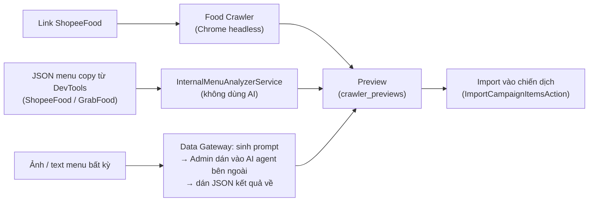

# 19. Nhập menu: Food Crawler & Data Gateway

[← Về Tổng quan nghiệp vụ](overview.md)

Khi tạo chiến dịch ([bài 3](03-chien-dich-gom-don.md)), Admin có thể nạp menu tự động thay vì nhập tay từng món. Mọi nguồn đều cho ra **cùng một schema menu JSON của DrinkFlow** và đi qua bước **xem trước** trước khi ghi vào `CampaignItem`.

## 19.1. Food Crawler

- Admin dán link, hệ thống chọn provider phù hợp (`ProviderResolver`) và crawl ra menu chuẩn hoá (`FoodCrawlerGateway`). Hiện chỉ có **ShopeeFood** (`ShopeeFoodProvider`, link phải thuộc `shopeefood.vn`).
- Chạy Google Chrome headless qua Node.js/Puppeteer từ PHP (`shell_exec`) — cấu hình `FOOD_CRAWLER_*` trong `.env`. Bảo vệ mạng: chỉ crawl qua HTTPS và chặn mọi địa chỉ mạng nội bộ (SSRF).
- Kết quả lưu tạm vào `crawler_previews` để xem trước (`admin.crawler.preview`), rồi nhập vào chiến dịch (`admin.crawler.import`). Bản xem trước bị xoá sau `RETENTION_CRAWLER_PREVIEWS_DAYS` ngày (mặc định 2) bởi lệnh `drinkflow:prune-crawler-and-logs`.

## 19.2. Data Gateway

Hai cách, dùng khi không crawl được:

1. **Phân tích nội bộ** (`admin.data-gateway.analyze`, `InternalMenuAnalyzerService`): dán JSON phản hồi menu của ShopeeFood/GrabFood (copy từ DevTools). Quy tắc chuyển đổi:
   - nhóm tuỳ chọn không bắt buộc (min = 0) → `toppings`;
   - **một** nhóm bắt buộc chọn một → `options` (ưu tiên nhóm size, nếu không thì nhóm đầu tiên làm thay đổi giá); các nhóm bắt buộc khác bị bỏ qua và được báo lại;
   - nhóm đá/đường bị bỏ qua (đơn DrinkFlow có mức đá/đường riêng);
   - món/lựa chọn hết hàng bị bỏ; món nằm ở nhiều danh mục chỉ giữ một lần.
2. **Sinh prompt cho AI bên ngoài** (`admin.data-gateway.generate-prompt`, `DataGatewayConverterService`): chọn nền tảng + AI agent, hệ thống sinh prompt (đa ngôn ngữ, tối ưu token) kèm schema JSON chuẩn; Admin tự dán prompt + ảnh/text menu vào AI rồi dán JSON trả về để xem trước. **DrinkFlow không gọi API của AI nào** và không lưu khoá AI.

## 19.3. Sau khi nhập

Món nhập vào chỉ tồn tại trong phạm vi chiến dịch đó (không có danh mục "Sản phẩm" dùng chung). Admin vẫn sửa/xoá/thêm món, size, topping, trạng thái (`Active` / `SoldOut` / `Inactive`) trước và sau khi phát động. Giá luôn được tính lại từ CSDL khi đặt món ([bài 4](04-dat-mon-gio-hang.md)).

## Tham chiếu mã nguồn

`App\Services\FoodCrawler\FoodCrawlerGateway`, `ProviderResolver`, `Providers\ShopeeFoodProvider`, `Browser\*` · `App\Services\DataGateway\InternalMenuAnalyzerService`, `DataGatewayConverterService` · `App\Http\Controllers\Admin\CrawlerController`, `DataGatewayController` · `App\Actions\Campaign\ImportCampaignItemsAction` · `config/retention.php` · Cấu hình máy chủ: [`documents/deploy/standalone-vps-deployment.md`](../deploy/standalone-vps-deployment.md) mục 3.6.
