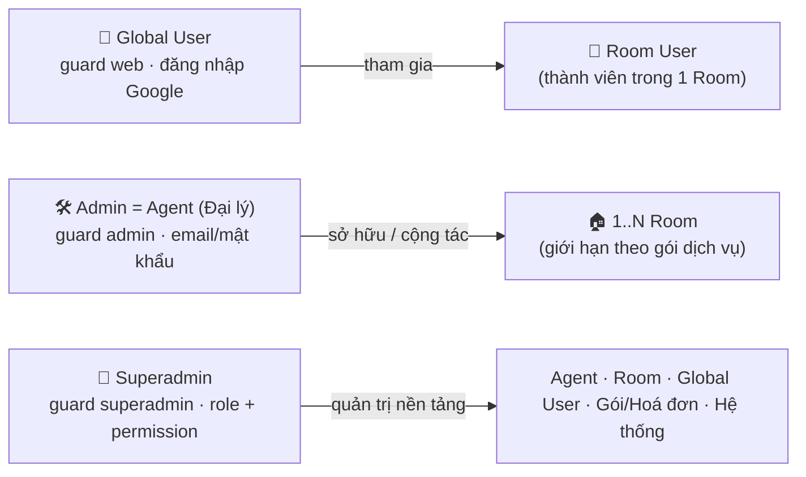
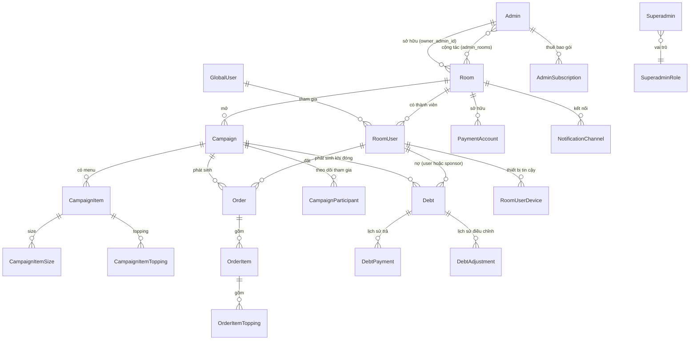

# Tổng quan nghiệp vụ DrinkFlow

Tài liệu này phân tích DrinkFlow theo **từng nghiệp vụ** (business domain) thay vì theo vai trò người dùng — mục tiêu là hiểu **luồng dữ liệu, quy tắc nghiệp vụ và vòng đời trạng thái** đứng sau các màn hình, để phát triển/bảo trì hệ thống chính xác hơn.

> Khác với tài liệu hướng dẫn thao tác ([`src/public/guide-content/user/`](../../src/public/guide-content/user/README.md), [`src/public/guide-content/admin/`](../../src/public/guide-content/admin/README.md), [`src/resources/guide-content/superadmin/`](../../src/resources/guide-content/superadmin/README.md)) vốn mô tả **"bấm nút gì"**, tài liệu này mô tả **"hệ thống xử lý ra sao"**: Model, Enum trạng thái, Action/Service, Event và các công thức tính toán thực tế trong mã nguồn.
>
> Đối chiếu lần cuối với mã nguồn: **2026-11-02**.

## Ba nhóm tác nhân (Actor) – ba guard đăng nhập độc lập

- **Global User** (`App\Models\GlobalUser`): danh tính duy nhất toàn hệ thống, có thể là thành viên (`RoomUser`) của nhiều Room.
- **Admin / Agent** (`App\Models\Admin`): khách hàng của nền tảng (mô hình SaaS). Tự đăng ký, được Superadmin duyệt kèm một gói dịch vụ, rồi **tự tạo và sở hữu Room** (`rooms.owner_admin_id`) trong hạn mức của gói; có thể mời Admin khác làm cộng tác viên (`admin_rooms`).
- **Superadmin** (`App\Models\Superadmin`): bảng và guard riêng, **không phải** một vai trò của Admin. Quyền hạn chi tiết theo `SuperadminRole` + danh mục permission (middleware `permission:<key>`).

## Mục lục nghiệp vụ

| # | Nghiệp vụ | Trạng thái/Enum chính | Actor liên quan |
| - | --------- | ---------------------- | ---------------- |
| 1 | [Xác thực & Phân quyền](01-xac-thuc-phan-quyen.md) | `GlobalUserStatus`, `AdminStatus`, `SuperadminStatus` | Cả 3 |
| 2 | [Quản lý Room & Thành viên](02-quan-ly-room-thanh-vien.md) | `RoomStatus`, `RoomUserStatus` | User, Admin |
| 3 | [Chiến dịch gom đơn](03-chien-dich-gom-don.md) | `CampaignStatus`, `CampaignItemStatus` | Admin, User |
| 4 | [Đặt món & Giỏ hàng](04-dat-mon-gio-hang.md) | `CampaignParticipant.status`, `OrderPlacementType` | User, Admin |
| 5 | [Vận hành đơn hàng](05-van-hanh-don-hang.md) | `OrderStatus`, `PaymentStatus` | Admin, User |
| 6 | [Chính sách Tài trợ (Sponsor)](06-chinh-sach-tai-tro.md) | `Campaign::SPONSOR_TYPE_*` | Admin |
| 7 | [Thanh toán & Công nợ](07-thanh-toan-cong-no.md) | `DebtStatus`, `DebtAdjustmentType`, `PaymentMethod`, `BillSplitMethod` | Admin, User |
| 8 | [Thông báo & Realtime](08-thong-bao-realtime.md) | `NotificationType` | Cả 3 |
| 9 | [Báo cáo & Thống kê](09-bao-cao-thong-ke.md) | `AnalyticsPeriod` | Cả 3 |
| 10 | [Bảo mật, Thiết bị & Audit](10-bao-mat-thiet-bi-audit.md) | Device trust, `AuditLog`, `SecurityEvent` | Cả 3 |
| 11 | [Quản trị nền tảng (Superadmin)](11-quan-tri-he-thong-superadmin.md) | `SuperadminRole`, `Permission` | Superadmin |
| 12 | [Gói dịch vụ, Thuê bao & Hoá đơn nền tảng](12-goi-dich-vu-thue-bao-hoa-don.md) | `PackageStatus`, `SubscriptionStatus`, `InvoiceStatus` | Admin, Superadmin |
| 13 | [Đồng bộ ngân hàng & Quỹ phòng](13-dong-bo-ngan-hang-quy-phong.md) | `BankTransactionStatus`, `RoomFundTransactionType` | Admin |
| 14 | [Vòng quay may mắn](14-vong-quay-may-man.md) | `SponsorDrawStatus`, `SponsorDrawType` | Admin, User |
| 15 | [Huy hiệu Top 3 nhà tài trợ & Thành tích](15-huy-hieu-nha-tai-tro-thanh-tich.md) | `monthly_sponsor_statistics` | User, Admin |
| 16 | [Tổng kết năm](16-tong-ket-nam.md) | `member_year_recaps` | User |
| 17 | [Sinh nhật & Dịp lễ](17-sinh-nhat-dip-le.md) | `RoomOccasion` | User, Admin |
| 18 | [Tiện ích: Trò chơi & Kênh thông báo](18-tro-choi.md) | `GameRoomStatus`, `GameResultStatus`, `GameNotificationChannel` | User, Superadmin |
| 19 | [Nhập menu: Food Crawler & Data Gateway](19-nhap-menu-crawler-data-gateway.md) | — | Admin |
| 20 | [Góp ý, Liên hệ, Phiên bản & Hướng dẫn](20-gop-y-lien-he-phien-ban-huong-dan.md) | `FeedbackStatus`, `ContactTopic` | Cả 3 |

## Sơ đồ quan hệ dữ liệu cốt lõi (rút gọn)

## Nguồn đối chiếu

- `app/Enums/*.php` — định nghĩa trạng thái chính thức.
- `app/Actions/**/*.php`, `app/Services/**/*.php` — logic nghiệp vụ thực thi.
- `app/Events/*.php`, `app/Listeners/*.php` — luồng sự kiện/realtime.
- `app/Policies/*.php`, `app/Http/Middleware/*.php` — phân quyền.
- `routes/web.php`, `routes/user.php`, `routes/admin.php`, `routes/superadmin.php`, `routes/console.php` — bề mặt route và lịch chạy nền theo từng actor.
